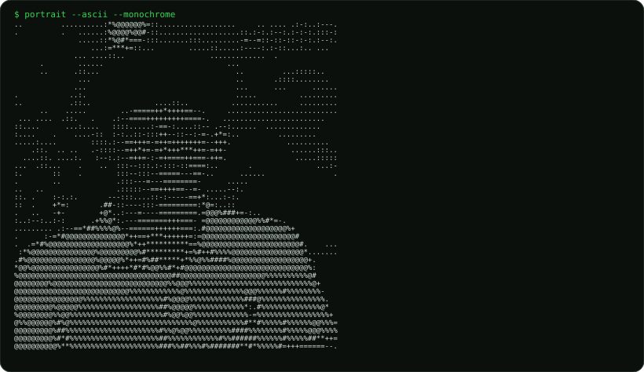
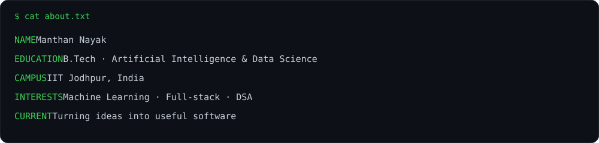
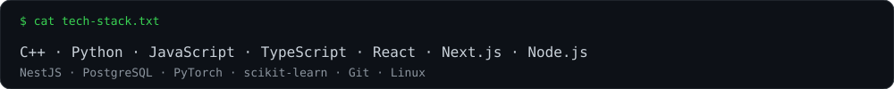
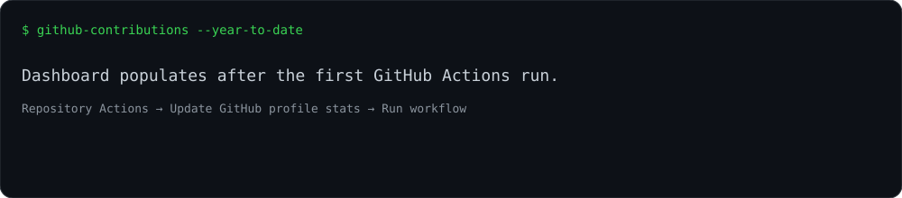

  

  

## `$ ./current_focus.sh`

- Exploring **AI / Machine Learning** and practical applications.
- Building full-stack products and improving software engineering fundamentals.
- Practising **Data Structures & Algorithms** and problem solving.
- Learning by shipping projects, experimenting, and iterating.

## `$ ls ./projects`

| Project | What it does |
|---|---|
| **Koda** | A coding platform with a structured DSA roadmap, learning paths, ratings, and leaderboard features. |
| **VisionTrack AI** | A computer-vision project exploring person retrieval and visual-attribute matching in CCTV footage. |
| **ParentCare360** | A remote elder-care management system concept focused on connected care and monitoring. |
| **Mess Rebate Management System** | A web-based platform for managing mess rebate applications, automating student requests, and streamlining administrative approvals. |
| **Image Segmentation** | A computer vision project focused on pixel-level image classification and segmentation for accurate object and region identification. |
| **SQORA** | A database-focused platform for writing, executing, and managing SQL queries through an intuitive interface. |

## `$ cat tech-stack.txt`

  

**Languages:** C++, Python, JavaScript, TypeScript  
**Frontend:** HTML, CSS, React, Next.js, Tailwind CSS  
**Backend & Data:** Node.js, NestJS, PostgreSQL, Prisma  
**AI / ML:** PyTorch, scikit-learn, NumPy, Pandas, Jupyter  
**Tools:** Git, GitHub, Linux, VS Code

## `$ ./contributions.sh`

  

  
  

## `$ connect --with me`

  
  

  

